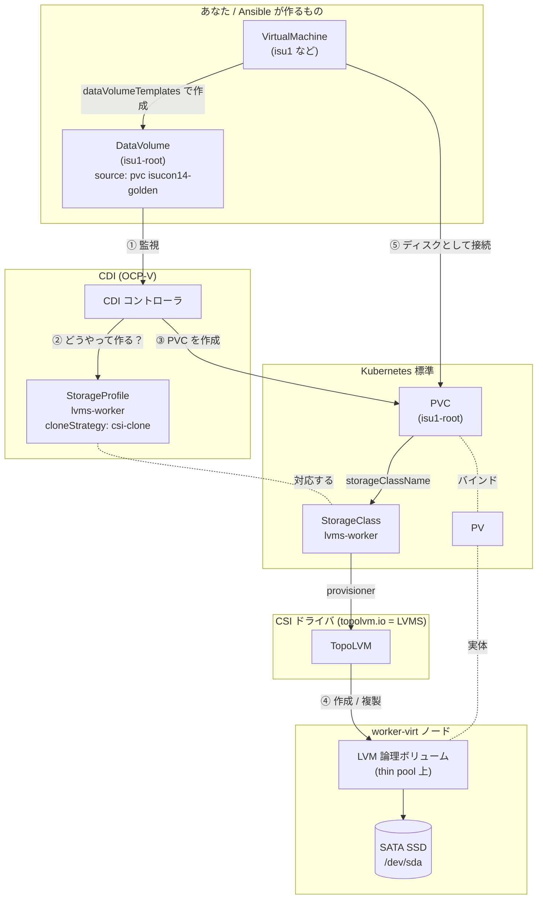
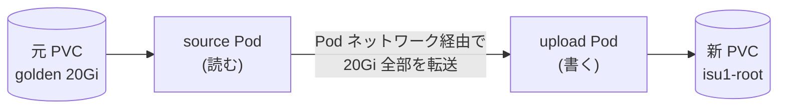
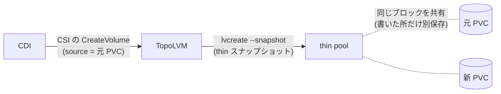

# OCP-V のストレージの仕組み（DataVolume / CDI / StorageProfile / CSI）

VM のディスクがどう作られているかを、この環境（`lvms-worker`）を例に説明します。

## 1. 登場人物

| 名前 | 種類 | 一言でいうと | たとえ |
|---|---|---|---|
| **PVC** (PersistentVolumeClaim) | Kubernetes 標準 | 「ディスクをください」という申込書。VM のディスクの実体はこれ | SSD の購入申込 |
| **PV** (PersistentVolume) | Kubernetes 標準 | 実際に割り当てられたディスク | 届いた SSD |
| **StorageClass** | Kubernetes 標準 | どのストレージから、どの CSI ドライバで作るか | 「SSD 置き場 A から出して」 |
| **CSI ドライバ** | Kubernetes 標準の規格 | ストレージ製品ごとの「作る・消す・複製する」を実際に実行するプラグイン（LVMS なら `topolvm.io`） | 倉庫の管理人 |
| **DataVolume (DV)** | CDI (OCP-V) | 「**中身入りの** PVC を作って」という注文書。中身の入手方法（URL / 別の PVC の複製 など）を書ける | 「この SSD の複製を 1 本ください」という発注書 |
| **CDI** (Containerized Data Importer) | OCP-V の部品 | DV を見て、PVC を作り、中身を入れる係 | 発注を受けて動く作業員 |
| **StorageProfile** | CDI | StorageClass ごとの「CDI 向け作業マニュアル」。**クローンのやり方**などを決める | 作業員向けマニュアル |

ポイント:

- **Kubernetes 標準**（PVC / PV / StorageClass / CSI）は「空のディスクを作る」までしか面倒を見ない
- **CDI**（DataVolume / StorageProfile）は OCP-V が足した層で、「**中身を入れる**」（イメージ取り込み・複製）を担当する

## 2. 全体の関係図



流れ:

1. VM を作ると、`dataVolumeTemplates` から DataVolume が作られる
2. CDI が DataVolume を見つけ、StorageProfile で「この StorageClass はどう扱うか」を確認する
3. CDI が PVC を作る
4. PVC の StorageClass から CSI ドライバ（TopoLVM）が呼ばれ、LVM のボリュームが作られる / 複製される
5. 準備ができたら VM が起動し、PVC をディスクとして使う

## 3. クローン方式の違い（今回の遅さの原因）

StorageProfile の `cloneStrategy` で、CDI の複製のやり方が変わります。

### copy（host-assisted）: 変更前



- CDI が Pod を 2 つ立て、**中身を全部読んで、全部書く**
- 時間はデータ量に比例する（今回: 20Gi で約 10 分、4 本並列で約 38 分）
- どんなストレージでも動く「最後の手段」

### csi-clone: 変更後



- CDI は「複製して」と CSI ドライバに頼むだけで、データは運ばない
- LVM の thin スナップショットなので、**記録を作るだけで一瞬**。容量も書き換えた分しか増えない（copy-on-write）
- 実測: 20Gi のクローンが **約 6 秒**

### 比較

| | copy | csi-clone |
|---|---|---|
| データの移動 | 全量 | なし |
| 20Gi の複製（実測） | 約 10 分 | 約 6 秒 |
| 追加の容量 | 20Gi | 書き換えた分だけ |
| 条件 | なし | CSI ドライバがクローンに対応していること<br/>LVMS の場合: thin pool 構成、**元と同じノード**、同じ StorageClass / volumeMode |

## 4. この環境の設定

```sh
# 確認
oc get storageprofile -o custom-columns='NAME:.metadata.name,SPEC:.spec.cloneStrategy,STATUS:.status.cloneStrategy'
```

| StorageProfile | spec（人が指定） | status（実際に使う値） |
|---|---|---|
| lvms-master | csi-clone | csi-clone |
| lvms-worker | csi-clone | csi-clone |
| nfs-csi | （未指定） | copy |

- `spec` が空のときは、CDI が自動で決めた値が `status` に入る（LVMS の既定は copy だった）
- StorageProfile は **StorageClass ごと** の設定。lvms を変えても nfs-csi には影響しない

```sh
# 変更
oc patch storageprofile lvms-worker --type merge -p '{"spec":{"cloneStrategy":"csi-clone"}}'

# 元に戻す
oc patch storageprofile lvms-worker --type merge -p '{"spec":{"cloneStrategy":null}}'

# 実際のクローンでどの方式が使われたかを確認
oc get dv -n isucon14 -o custom-columns='NAME:.metadata.name,CLONE:.metadata.annotations.cdi\.kubevirt\.io/cloneType'
```

## 参考

- [Setting a default cloning strategy by using a storage profile (OCP 4.22)](https://docs.redhat.com/en/documentation/openshift_container_platform/4.22/html-single/virtualization/index#virt-customizing-storage-profile-default-cloning-strategy_virt-configuring-storage-profile)
- [CSI volume cloning (OCP 4.22 Virtualization)](https://docs.redhat.com/en/documentation/openshift_container_platform/4.22/html-single/virtualization/index#csi-volume-cloning_virt-creating-vms-cli)
- [Limitations for creating volume clones in multi-node topology (LVMS)](https://docs.redhat.com/en/documentation/openshift_container_platform/4.22/html-single/storage/index#lvms-about-volume-clones-limits_logical-volume-manager-storage)
